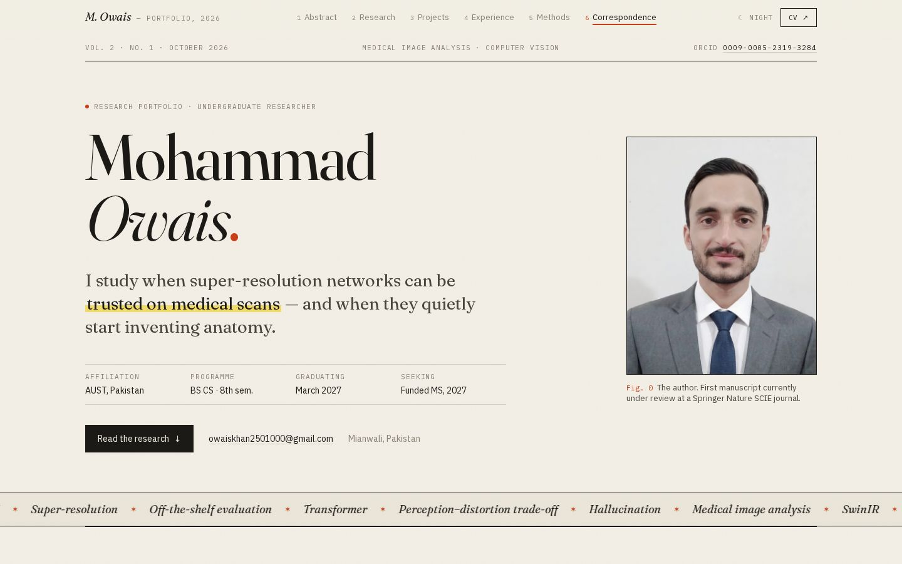
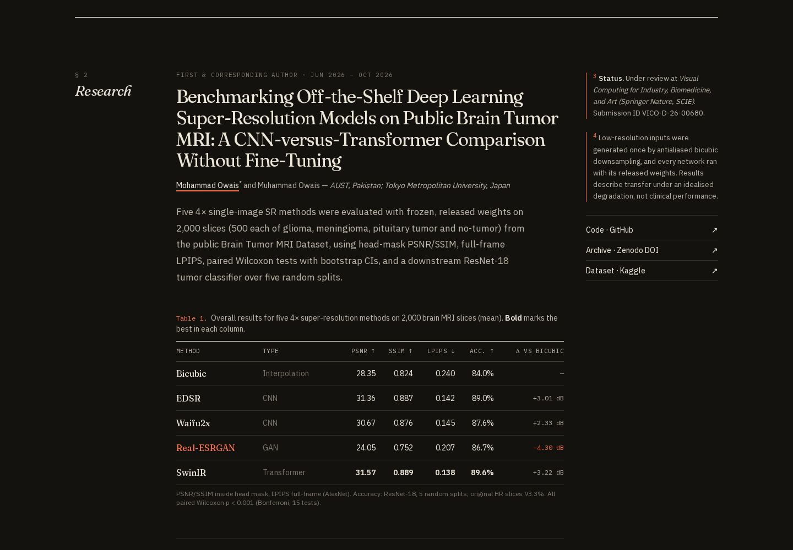

<div align="center">

# Mohammad Owais — Research Portfolio

**Undergraduate Researcher · Medical Image Analysis · Brain MRI Super-Resolution**

Making medical images sharper without making things up.

[](https://owais-portfolio-web.vercel.app)
[](https://orcid.org/0009-0005-2319-3284)
[](https://doi.org/10.5281/zenodo.23467749)




</div>

---

## About

This is the source of my personal academic portfolio. Version 2.0 is a full rewrite. The old site focused on animation and web development. This version is about my current research: whether deep-learning super-resolution models can be trusted on medical images.

I'm a final-year **BS Computer Science** student at **Abbottabad University of Science and Technology (AUST)**, Pakistan, graduating in March 2027. I'm looking for **fully-funded MS / research positions** in medical image analysis and computer vision.

## Featured research

> **Benchmarking Off-the-Shelf Deep Learning Super-Resolution Models on Public Brain Tumor MRI: A CNN-versus-Transformer Comparison Without Fine-Tuning**
> Mohammad Owais\*, Muhammad Owais. AUST, Pakistan · Faculty of Systems Design, Tokyo Metropolitan University, Japan
> *Under review at Visual Computing for Industry, Biomedicine, and Art (Springer Nature, SCIE). Submission ID VICO-D-26-00680*

| Method | Type | PSNR (mask) ↑ | SSIM (mask) ↑ | LPIPS ↓ | ResNet-18 Acc. ↑ |
|---|---|---|---|---|---|
| Bicubic | Interpolation | 28.35 dB | 0.824 | 0.240 | 84.0 % |
| EDSR | CNN | 31.36 dB | 0.887 | 0.142 | 89.0 % |
| Waifu2x | CNN | 30.67 dB | 0.876 | 0.145 | 87.6 % |
| Real-ESRGAN | GAN | 24.05 dB | 0.752 | 0.207 | 86.7 % |
| **SwinIR** | **Transformer** | **31.57 dB** | **0.889** | **0.138** | **89.6 %** |

<sub>n = 2,000 slices, 4× upscaling, frozen pretrained weights. Original HR accuracy: 93.3 %. All paired Wilcoxon tests p &lt; 0.001 (Bonferroni-corrected).</sub>

🔗 [Code (GitHub)](https://github.com/owaiskhan2501000/Brain-MRI-SR-Benchmark) · [Zenodo archive](https://doi.org/10.5281/zenodo.23467749) · [Dataset (Kaggle)](https://doi.org/10.34740/KAGGLE/DSV/2645886)

<div align="center">

</div>

## Design: "The Manuscript"

Most developer portfolios share the same look: dark background, gradient glow, rounded cards. This site is designed like a **typeset journal article** instead, because research is what it is about.

- **Title page hero.** A masthead strip (volume, issue, ORCID), a large serif name, an author/affiliation block, and a plain portrait captioned as *Fig. 0*.
- **Manuscript grid.** Each section has its § number and italic title in the left margin, the text in the middle, and Tufte-style **sidenotes** with red footnote marks on the right.
- **Booktabs Table 1.** The real benchmark results, set with heavy top and bottom rules and the best value in each column in bold.
- **Interactive Fig. 1.** A hand-drawn SVG of the perception–distortion plane (PSNR against LPIPS). It shows Real-ESRGAN's −4.30 dB drop, and hovering a table row highlights the matching point.
- **Paper and ink palette.** Warm paper, ink-black text, one red-pencil accent and a yellow highlighter mark. Square corners, hairline rules and a subtle paper-grain texture.
- **Typography.** Fraunces (variable serif) for display, IBM Plex Sans for body text and IBM Plex Mono for figure labels.
- **Day and night reading modes.** Night mode is a dark-paper version, not a generic dark theme.
- **Details.** A drop cap on the abstract, references-style manuscript list, tally-bar language levels, a "Cite this page" colophon, and an "Erratum 404" page.

## Features

- **Keyword ticker.** Built with pure CSS keyframes, so it runs on desktop and mobile. It keeps scrolling (more slowly) even when Windows "Animation effects" is switched off, and pauses on hover.
- **Accessible.** Semantic HTML, a skip link, visible focus rings, ARIA labels, and support for reduced motion.
- **SEO.** Metadata API, an auto-generated Open Graph image, JSON-LD `Person` schema, a sitemap, robots.txt and a web manifest.
- **Fast.** Fully static pages, `next/image` (AVIF/WebP), self-hosted fonts, and no video files.
- **Contact form.** Uses Web3Forms with a honeypot field for spam. Without an API key, it opens the visitor's email client instead.
- **All content in one file.** Everything shown on the site lives in `lib/data.ts`.

## Tech stack

| Layer | Technology |
|---|---|
| Framework | [Next.js 16](https://nextjs.org) (App Router, Turbopack, static export-ready) |
| UI | React 19, TypeScript (strict) |
| Styling | Tailwind CSS v4 (CSS-first `@theme` tokens) |
| Animation | [Motion](https://motion.dev) (`motion/react`) |
| Graphics | Hand-built SVG figure + custom brand icons |
| Theming | `next-themes` |
| Fonts | Fraunces, IBM Plex Sans, IBM Plex Mono (via `next/font`) |
| Linting | ESLint 9 flat config + `eslint-config-next` |

## Project structure

```
owais-portfolio-web/
├── app/
│   ├── layout.tsx            # Root layout, fonts, SEO metadata, JSON-LD
│   ├── page.tsx              # Home page — composes all sections
│   ├── globals.css           # Tailwind v4 + design tokens (light/dark)
│   ├── opengraph-image.tsx   # Auto-generated social preview image
│   ├── not-found.tsx         # Custom 404
│   ├── sitemap.ts · robots.ts · manifest.ts
│   └── favicon.ico · apple-icon.png
├── components/
│   ├── navbar.tsx            # Sticky nav, active-section pill, mobile menu
│   ├── footer.tsx
│   ├── theme-provider.tsx · theme-toggle.tsx
│   ├── sections/             # hero · abstract · research · projects · experience · skills · contact
│   └── ui/                   # section (manuscript grid + sidenotes) · reveal · counter · brand-icons
├── lib/
│   ├── data.ts               # ← ALL portfolio content lives here
│   └── utils.ts
├── public/
│   ├── Mohammad_Owais_CV.pdf
│   └── profile-hr.webp       # Portrait
├── docs/                     # README screenshots
├── .env.example
└── next.config.ts · tsconfig.json · eslint.config.mjs · postcss.config.mjs
```

## Getting started

**Requirements:** Node.js **≥ 20.9** and npm.

```bash
# 1. Clone
git clone https://github.com/owaiskhan2501000/owais-portfolio-web.git
cd owais-portfolio-web

# 2. Install dependencies
npm install

# 3. (Optional) configure environment variables
cp .env.example .env.local

# 4. Start the dev server → http://localhost:3000
npm run dev
```

### Scripts

| Command | Description |
|---|---|
| `npm run dev` | Start the development server (Turbopack) |
| `npm run build` | Create an optimized production build |
| `npm run start` | Serve the production build |
| `npm run lint` | Run ESLint |
| `npm run typecheck` | Run the TypeScript compiler without emitting |

### Environment variables

| Variable | Required | Purpose |
|---|---|---|
| `NEXT_PUBLIC_WEB3FORMS_ACCESS_KEY` | No | Turns on direct contact-form submissions. Get a free key at [web3forms.com](https://web3forms.com). If it's missing, the form opens a `mailto:` link instead. |
| `NEXT_PUBLIC_SITE_URL` | No | Canonical URL used for SEO, the sitemap and OG images. Default: `https://owais-portfolio-web.vercel.app` |

## Updating content

You don't need to touch any components. Edit **`lib/data.ts`**:

- `profile`: name, role, tagline, contact details, social links
- `about`: abstract paragraphs, keywords/interests, headline stats
- `keywords`: words in the scrolling ticker
- `research`: manuscript details, results table, highlights, links
- `projects`, `timeline`, `skills`, `certifications`, `languages`, `references`

To replace the CV, overwrite `public/Mohammad_Owais_CV.pdf`.

## Deployment (Vercel)

1. Push to GitHub.
2. Import the repository at [vercel.com/new](https://vercel.com/new). Vercel detects Next.js automatically.
3. Add the environment variables above in **Project → Settings → Environment Variables** (optional).
4. Deploy. Every push to `main` redeploys automatically.

## What changed from v1

| v1 (old) | v2 (this version) |
|---|---|
| A single 840-line `page.tsx` | Modular components plus one content file |
| Positioned as animator / web developer | Positioned as a medical-imaging researcher |
| Clerk authentication (not needed) | Removed. Faster, with no sign-in friction |
| About 40 MB of background videos | Lightweight images and CSS effects |
| Generic "AI-template" look | One-of-a-kind journal-article design |
| Dark mode only | Day and night reading modes |
| Outdated projects and certifications | Current research, FYP, MRI pipeline, RAG system |
| Default create-next-app README | This README |

## Contact

- **Email:** [owaiskhan2501000@gmail.com](mailto:owaiskhan2501000@gmail.com)
- **LinkedIn:** [mohammad-owais-cs-13607ai](https://linkedin.com/in/mohammad-owais-cs-13607ai)
- **ORCID:** [0009-0005-2319-3284](https://orcid.org/0009-0005-2319-3284)
- **GitHub:** [@owaiskhan2501000](https://github.com/owaiskhan2501000)

## License

The **source code** is released under the [MIT License](LICENSE). Feel free to use it as a template for your own portfolio.
Personal content (CV, photo, manuscript details and text) © 2026 Mohammad Owais. Please don't reuse it.

<div align="center"><sub>Typeset in Mianwali, Pakistan</sub></div>
